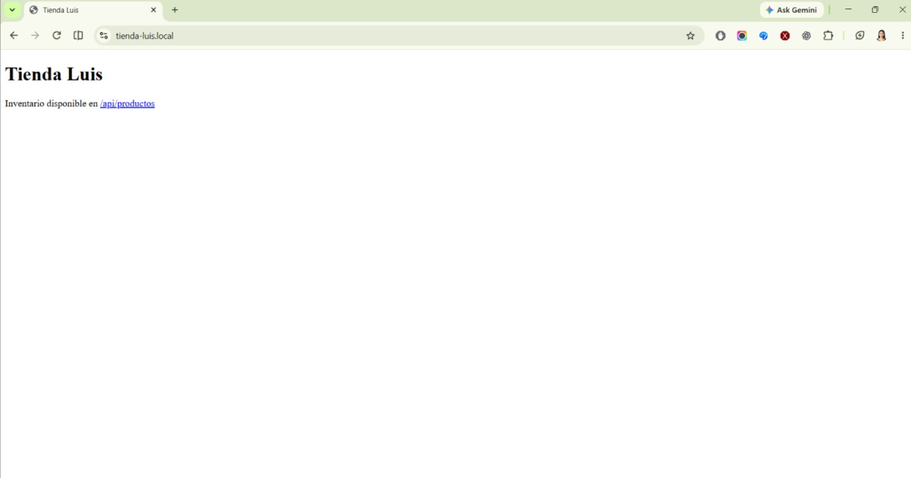
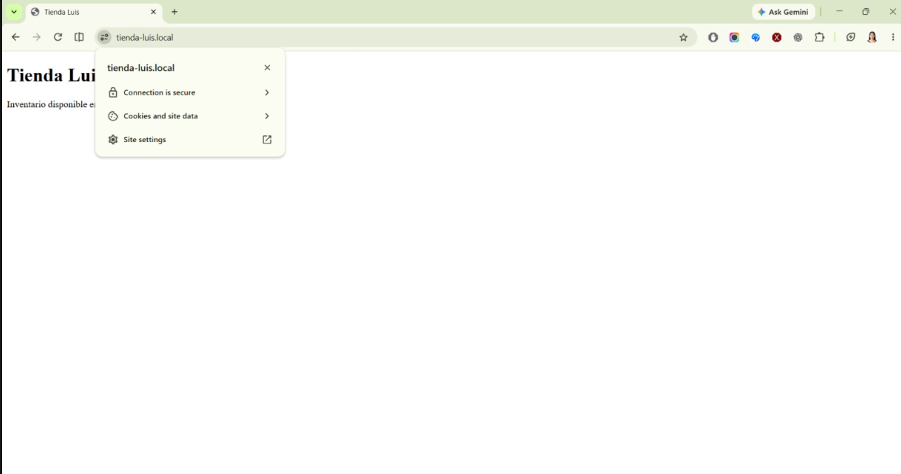

# Tienda Luis — Fase 2

## Objetivo

Presentar la conexión del sitio de Tienda Luis con la API de inventario mediante Apache, ProxyPass y HTTPS.

## Arquitectura

```text
PERSONAL DE TIENDA LUIS
          │
          │ HTTPS
          ▼
┌─────────────────────────────┐
│ PC 2: APACHE                │
│ Sirve el sitio HTML/CSS     │
└──────────────┬──────────────┘
               │ ProxyPass /api/
               ▼
┌─────────────────────────────┐
│ EXPRESS — API (puerto 7000) │
│ En la misma PC que Apache   │
└──────────────┬──────────────┘
               │ Lee y guarda
               ▼
         productos.json
```

Apache sirve el HTML estático y reenvía las solicitudes de la API a Express. En la configuración actual, Apache y Express se ejecutan en la misma computadora porque el proxy se conecta a `localhost:7000`. Los nodos adicionales y el balanceador pertenecen a fases posteriores.

## Ejecución

En la computadora donde están configurados Apache y el backend, abra PowerShell en la raíz del repositorio y ejecute:

```powershell
cd .\tiendaLuis.local
npm ci
npm run dev
```

Mantenga abierta esa ventana para que Express siga ejecutándose en el puerto `7000`. Apache es un servicio aparte; en la PC que aloja el sitio, se inicia con:

```bash
sudo systemctl start apache2
```

Apache sirve `tiendaLuis.local/frontend/index.html` desde `/var/www/tienda_luis`. El virtual host `tiendaLuis.local/apache/tienda_luis-ssl.conf` redirige HTTP a HTTPS y reenvía `/api/` al backend.

## Acceso al sitio y a la API

En el entorno configurado del equipo, abra:

- Sitio: `http://tienda-luis.local/` (Apache redirige a `https://tienda-luis.local/`).
- API a través de Apache: `https://tienda-luis.local/api/productos`.
- API directa de Express: `http://localhost:7000/productos`.

`npm run dev` inicia la API, no el HTML. Si abre `http://localhost:7000/`, Express responde `Cannot GET /` porque no hay una ruta raíz; para ver el HTML, utilice `tienda-luis.local`.

## Seguridad y evidencias HTTPS

Apache usa el certificado público `tiendaLuis.local/apache/tienda-luis.local.pem`. La llave privada se mantiene fuera del repositorio y está excluida mediante `.gitignore`. En el entorno del equipo, el sitio se muestra en HTTPS con el candado y sin advertencias.



