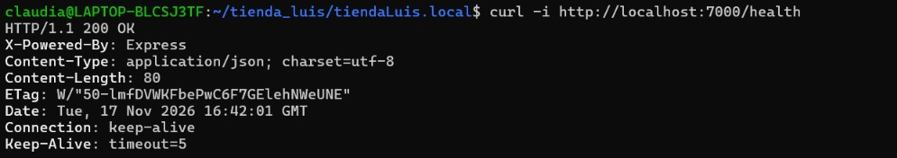
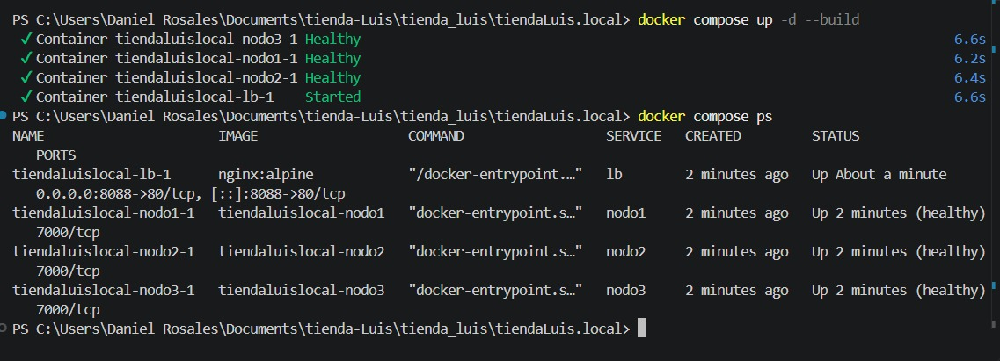
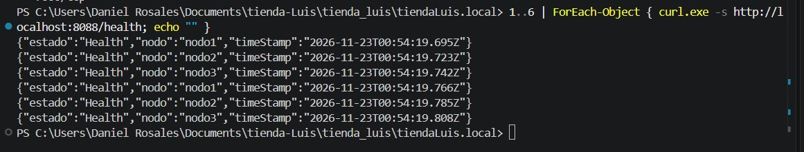
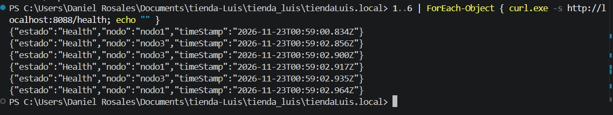
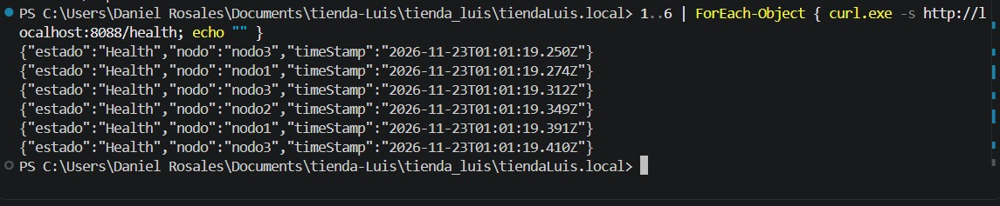

## Contenedorización Base del Backend (Node.js & Docker)

Se implementó la contenedorización del microservicio backend de la tienda utilizando una imagen ligera basada en node:20-alpine para optimizar el rendimiento y reducir la superficie de ataque. Mediante un archivo Dockerfile, se configuró la gestión de dependencias, la compilación del código fuente de TypeScript y la exposición del *puerto 7000*, apoyándose en un archivo .dockerignore para mantener una compilación limpia y sin archivos innecesarios (node_modules, dist, .git).

### Validación del Contenedor (Health Check)
Se verificó el correcto despliegue local ejecutando pruebas de conectividad sobre el endpoint /health, confirmando la respuesta exitosa del servidor Express:

curl -i http://localhost:7000/health

## Infraestructura de clúster y balanceo de carga
Se implementó la orquestacion de contenedores mediante **docker compose** (`docker-compose yml`) para desplegar 3 réplicas independientes del backend (`nodo1`, `nodo2` y `nodo3`), superando el mínimo de 2 nodos requeridos. 

Asimismo, se configuró **Nginx** (`lb`) como proxy inverso y balanceador de carga frontal mediante un bloque `upstream`, exponiendo únicamente el puerto 8088 hacia el host y distribuyendo las peticiones entrantes de forma equitativa bajo el algoritmo **Round Robin**.

## Evidencias de implementación

1. **Despliegue de nodos y exposición exclusiva del balanceador:**
Se ejecutó `docker compose up -d` y `docker compose ps`, verificando que `nodo1`, `nodo2` y `nodo3` alcanzaron el estado `healthy` en el puerto interno `7000/tsp`, mientras que únicamente `lb` publicó el puerto 8088

2. **Segmentación en red privada interna (`clusternet`):**
Se inspeccionó la red puente con `docker network inspect clusternet` confirmando el direccionamiento privado asignado al balanceador (`172.20.0.2/24`) y a los tres nodos (`172.20.0.11/24`, `172.20.0.12/24` y `172.20.0.13/24`).

## Monitoreo de Salud y Pruebas de Failover

Se implementó el monitoreo activo de disponibilidad del clúster mediante el endpoint `GET /health` en Express (`src/index.ts`), retornando `HTTP 200 OK` junto con el identificador del nodo (`os.hostname()`) y la marca de tiempo (`timeStamp`) en operación normal, o `HTTP 503 Service Unavailable` mediante el parámetro `?simular=falla` para validar la detección automática de fallos y la redirección de tráfico en Nginx (`proxy_next_upstream`).

### Validación de Balanceo y Tolerancia a Fallos (Failover)
Se verificó la alta disponibilidad del sistema ejecutando ráfagas de peticiones sobre el balanceador (`http://localhost:8088/health`) antes, durante y después de detener un nodo del clúster, confirmando que el tráfico se redistribuye sin interrupciones hacia los nodos saludables:

**1. Nodos activos y saludables (`docker compose ps`)**

**2. Balanceo de carga y respuestas HTTP 200 en `/health`**

**3. Prueba de Failover (`nodo2` detenido y tráfico redirigido a `nodo1` y `nodo3`)**

**4. Recuperación del nodo (`nodo2` reactivado y saludable)**

