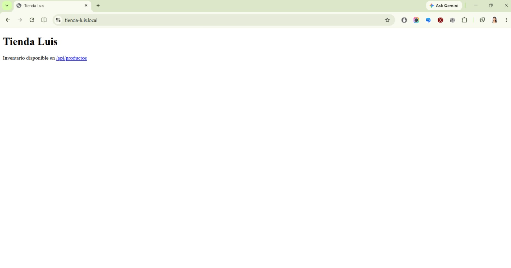
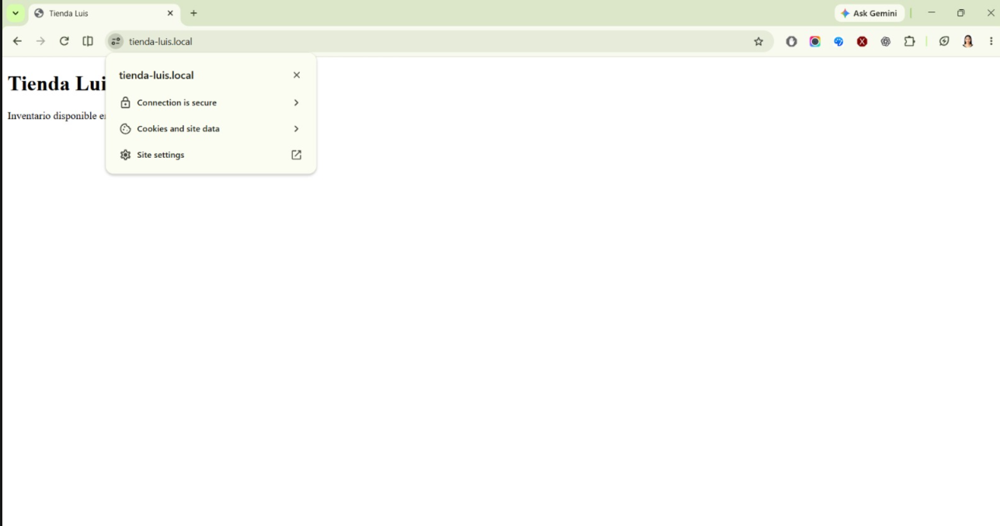

# Tienda Luis — Fase 2: Apache + HTTPS + ProxyPass

Documentación de la Fase 2 del proyecto: la conexión del sitio de Tienda Luis con
la API de inventario mediante Apache, ProxyPass y HTTPS. Fue la etapa previa al
clúster de la Fase 3 (ver `fase3.md`).

## Objetivo

Presentar la conexión del sitio de Tienda Luis con la API de inventario mediante
Apache, ProxyPass y HTTPS.

## Arquitectura

```text
PERSONAL DE TIENDA LUIS
          │
          │ HTTPS
          ▼
┌─────────────────────────────┐
│ PC 2: APACHE                │
│ Sirve el sitio HTML/CSS     │
└──────────────┬──────────────┘
               │ ProxyPass /api/
               ▼
┌─────────────────────────────┐
│ EXPRESS — API (puerto 7000) │
│ En la misma PC que Apache   │
└──────────────┬──────────────┘
               │ Lee y guarda
               ▼
         productos.json
```

Apache sirve el HTML estático y reenvía las solicitudes de la API a Express. En
la configuración de esta fase, Apache y Express se ejecutan en la misma
computadora porque el proxy se conecta a `localhost:7000`. Los nodos adicionales
y el balanceador corresponden a la Fase 3.

## Configuración realizada

- **Contenedor Express/TypeScript** (`src/index.ts`, `Dockerfile`): API de
  inventario con rutas dinámicas reales del negocio — CRUD completo
  `/productos`, más `/saludo`, `/info`, `/cotizacion` y `/health`.
- **Servidor web Apache**: virtual host
  `apache/tienda_luis-ssl.conf` que sirve el sitio estático
  `frontend/index.html` desde `/var/www/tienda_luis`, redirige HTTP a HTTPS y
  aplica `ProxyPass /api/ http://localhost:7000/` hacia el contenedor.
- **HTTPS**: certificado `apache/tienda-luis.local.pem` generado con mkcert. La
  llave privada (`*-key.pem`) se mantiene fuera del repositorio mediante
  `.gitignore`.

## Acceso al sitio y a la API

En el entorno configurado del equipo:

- Sitio: `http://tienda-luis.local/` (Apache redirige a `https://tienda-luis.local/`).
- API a través de Apache: `https://tienda-luis.local/api/productos`.
- API directa de Express: `http://localhost:7000/productos`.

`npm run dev` inicia la API, no el HTML. Si se abre `http://localhost:7000/`,
Express responde `Cannot GET /` porque no hay una ruta raíz; para ver el HTML se
utiliza `tienda-luis.local`.

## Seguridad y evidencias HTTPS

Apache usa el certificado público `apache/tienda-luis.local.pem`. La llave
privada se mantiene fuera del repositorio y está excluida mediante `.gitignore`.
En el entorno del equipo, el sitio se muestra en HTTPS con el candado y sin
advertencias.



